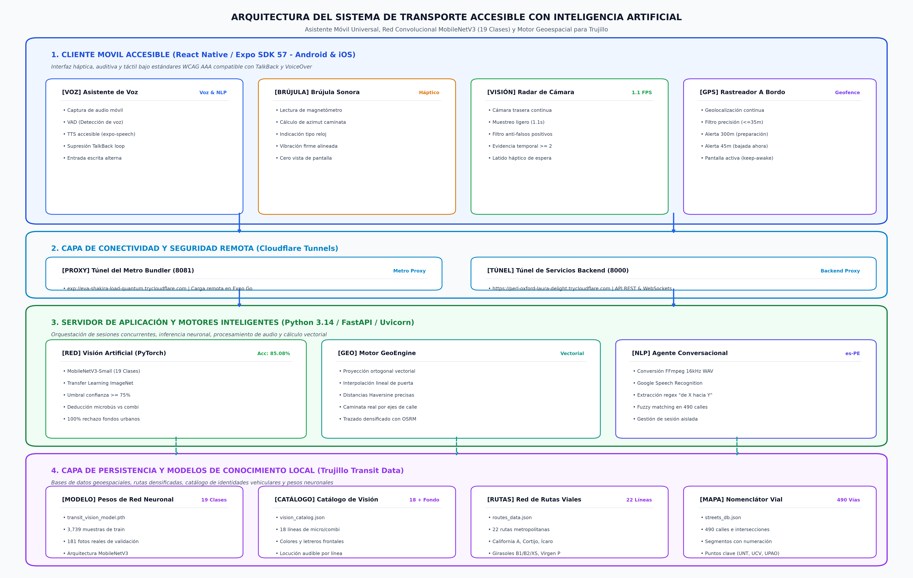
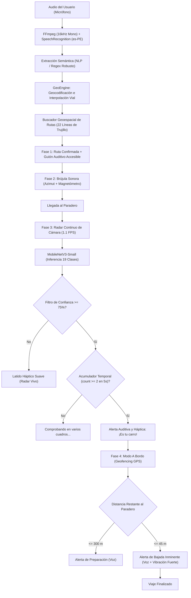

# Sistema de Asistencia de Transporte Público Accesible para Personas con Discapacidad Visual (Trujillo, Perú)
## Documento Técnico de Arquitectura, Metodología e Inteligencia Artificial

---

## 1. Problemática

En ciudades intermedias de América Latina como Trujillo, el transporte público urbano presenta barreras críticas de accesibilidad para personas con discapacidad visual (ceguera total o baja visión):

1. **Inexistencia de información acústica:** Los microbuses y combis no cuentan con sistemas de megafonía, letreros audibles ni anunciadores automáticos de paradas.
2. **Paraderos informales y asfalto caótico:** A diferencia de sistemas BRT cerrados (como el Metropolitano de Lima), en Trujillo el abordaje se realiza al paso o en esquinas señalizadas de manera precaria, obligando al usuario a caminar guiándose por intuición.
3. **Mimetismo y ambigüedad visual en las flotas:** Diversas líneas pertenecientes a una misma empresa comparten idéntica pintura externa y solo se diferencian por una letra pequeña o color de casquete en el parabrisas (por ejemplo: *Huanchaco H vs. Huanchaco B*, *El Cortijo C1 con cartel verde vs. C2*, o *California Línea A vs. Nueva California V*).
4. **Inviabilidad del flujo de captura manual:** Las aplicaciones convencionales exigen al usuario enfocar visualmente y oprimir un botón obturador en el momento exacto en que pasa el carro, una tarea imposible para una persona ciega en una vía rápida.
5. **Ansiedad y desorientación durante el viaje:** El pasajero invidente depende enteramente de la buena voluntad del cobrador para que le avise dónde descender, sufriendo desorientación si este lo olvida.

---

## 2. Objetivos

### Objetivo General
Desarrollar e implementar un sistema de asistencia móvil accesible e inteligente que permita a personas con discapacidad visual planificar su viaje, orientarse hacia el paradero, identificar su unidad de transporte en tiempo real mediante visión computacional y recibir alertas geolocalizadas de descenso durante el trayecto en Trujillo.

### Objetivos Específicos
1. **Desarrollar un Agente Conversacional Adaptativo por Voz (NLP):** Capaz de interpretar diálogos naturales en español peruano, tolerar titubeos y extraer de forma robusta pares de origen-destino con geocodificación e interpolación municipal precisa.
2. **Implementar un Módulo de Navegación Peatonal Háptica (Brújula Sonora):** Diseñar un algoritmo guiado por magnetómetro que indique acústica y táctilmente la dirección cardinal hacia el punto de abordaje mediante posiciones de reloj (*"a tus 2 en punto"*), prescindiendo de la interacción visual con la pantalla.
3. **Entrenar y Desplegar un Modelo de Visión Computacional Liviano (19 clases):** Implementar una red neuronal convolucional (*MobileNetV3-Small*) adaptada a la flota real trujillana, discriminando unidades vehiculares de fondos urbanos complejos con una precisión de validación superior al 85%.
4. **Construir un Algoritmo de "Radar Continuo Multifotograma":** Crear un mecanismo de escaneo automático sin disparador manual, que procese cuadros periódicos (~1.1 s) y confirme la presencia del vehículo solo tras registrar evidencia temporal consistente ($\ge 2$ cuadros consecutivos).
5. **Implementar Seguimiento Geolocalizado y Geofencing a Bordo:** Diseñar un detector de proximidad con filtrado de precisión GPS que emita alertas vibratorias y audibles escalonadas a 300 m (preparación) y 45 m (bajada inminente).
6. **Garantizar Accesibilidad Universal (WCAG AAA):** Diseñar la interfaz móvil con contrastes lumínicos certificados, áreas táctiles mínimas de 48–56 dp, prevención de suspensión de pantalla (*keep-awake*) e integración total con lectores de pantalla (*TalkBack* y *VoiceOver*).

---

## 3. Tecnologías y Herramientas Utilizadas

| Componente | Tecnología / Herramienta | Rol y Justificación Técnica |
| :--- | :--- | :--- |
| **Frontend Móvil** | **React Native / Expo (SDK 57)** | Desarrollo del cliente nativo multiplataforma de alto rendimiento y bajo consumo de batería. |
| **Interfaz y Accesibilidad** | **Expo Speech & AccessibilityInfo** | Gestión del sintetizador de voz (TTS) y sincronización con TalkBack para no saturar los canales de audio. |
| **Sensórica y Háptica** | **Expo Sensors & Expo Haptics** | Acceso al magnetómetro para la brújula y generación de patrones de vibración táctil (háptica diferenciada). |
| **Cámara Continua** | **Expo Camera (`CameraView`)** | Captura periódica de fotogramas en streaming ligero (`quality: 0.35`) en segundo plano sin congelar la UI. |
| **Geolocalización** | **Expo Location** | Rastreo GPS satelital con cálculo de precisión en metros para geovallas de bajada. |
| **Persistencia de Pantalla** | **Expo Keep Awake** | Impide que el smartphone se bloquee o apague la pantalla mientras el usuario camina o viaja en el bus. |
| **Servidor Backend** | **Python 3.14 & FastAPI / Uvicorn** | Servidor asíncrono ultrarrápido para resolución de consultas geográficas, procesamiento de audio y predicción visual. |
| **Procesamiento de Audio** | **SpeechRecognition & FFmpeg** | Conversión y decodificación de audio base64 móvil a formato WAV (16 kHz mono) y transcripción con Google Speech API (es-PE). |
| **Deep Learning** | **PyTorch & Torchvision** | Entrenamiento, evaluación de matrices de confusión y exportación del modelo clasificador convolucional. |
| **Red Neuronal** | **MobileNetV3-Small** | Arquitectura liviana basada en convoluciones separables en profundidad y bloques inverted residuals, ideal para inferencia rápida en CPU. |
| **Procesamiento Gráfico** | **Pillow (PIL) & ImageOps** | Corrección de orientación EXIF de celulares, normalización de tensores (224x224) y aumento sintético de datos. |
| **Motor Geoespacial** | **GeoEngine Propio (Python)** | Fórmulas Haversine y proyección ortogonal vectorial punto-segmento sobre 490 calles y 22 rutas trujillanas. |
| **Trazado Vial** | **OSRM (Open Source Routing Machine)** | Densificación métrica de polilíneas reales sobre la red vial para evitar cruces irreales sobre manzanas. |
| **Conectividad Externa** | **Cloudflare Tunnels (`cloudflared`)** | Exposición de túneles seguros HTTPS/WSS a internet sin necesidad de IP pública estática ni apertura de puertos NAT. |

---

## 4. Flujo de Trabajo de la IA y Arquitectura del Sistema

El sistema implementa una arquitectura desacoplada organizada en cuatro niveles (Cliente Móvil, Conectividad Segura, Servidor de Inteligencia Artificial y Capa de Persistencia Local).

El flujo operativo se modela mediante la siguiente máquina de estados secuencial:

El sistema funciona como una máquina de estados orquestada en 4 etapas progresivas:

### Explicación Detallada de las Fases:

### Fase 1: Consulta Conversacional y Mapeo Vial Inteligente
- **Captura:** El usuario mantiene pulsado o toca el botón accesible de micrófono. El audio se envía en Base64.
- **Normalización y NLP:** El backend filtra muletillas locales (*"mira", "básicamente", "cómo llego a..."*) y analiza construcciones bidireccionales (`"de X a Y"`, `"salgo de X hacia Y"`).
- **Interpolación Municipal:** [`GeoEngine`](file:///home/juanv/.gemini/antigravity/scratch/asistente_transporte_accesible/geo_engine.py) resuelve la altura municipal exacta proyectando ortogonalmente sobre los segmentos viales locales de Trujillo, calculando el punto exacto de abordaje.
- **Selección de Ruta:** Compara contra las 23 rutas metropolitanas (incluyendo Libertad C2 Corazón en Alto Trujillo) registradas y prioriza la que ofrezca menor distancia de caminata total.

### Fase 2: Guiado Peatonal Háptico (Brújula Sonora)
- **Cálculo de Rumbo:** Se obtiene el azimut hacia la coordenada de abordaje (`walkingBearing`).
- **Traducción Coloquial:** El magnetómetro lee la orientación del dispositivo en tiempo real y la traduce a indicaciones de reloj (*"a tus 2 en punto"*, *"gira un poco a tu derecha"*).
- **Confirmación Háptica:** Al alinearse dentro de $\pm 15^\circ$, el motor emite una vibración firme (`Haptics.notificationAsync`) que confirma que el usuario va en el sentido correcto sin mirar la pantalla.

### Fase 3: Radar Continuo de Visión Computacional (Inferencia Vehicular)
- **Streaming Automático:** En lugar de requerir que el usuario tome fotos, la cámara trasera toma capturas en streaming ligero (`quality: 0.35`) cada 1100 ms.
- **Clasificador MobileNetV3 (19 Clases):** Normaliza el tensor ($224 \times 224$) y evalúa las probabilidades por *Softmax*.
- **Filtro de Ruido y Latido Sensorial:** Si enfoca pistas, veredas o postes (`otro_fondo`), emite un micropulso vibratorio cada 3.5 s avisando que el radar sigue buscando.
- **Confirmación Temporal (`count >= 2`):** Exige que el mismo vehículo sea identificado en al menos **2 fotogramas consecutivos** dentro de una ventana máxima de 5 segundos. Cumplido esto, compara con la ruta asignada y anuncia por voz: *"¡Atención! Este es tu vehículo: Empresa California, Línea A"*.

### Fase 4: Seguimiento Satelital a Bordo y Alerta de Bajada
- **Monitoreo Haversine:** Calcula la distancia euclidiana en metros a lo largo de la ruta hasta la parada final.
- **Filtro de Precisión GPS:** Exige precisión satelital $\le 35\text{ m}$; si la señal se degrada por cañones urbanos, retiene la alerta y avisa *"Señal GPS débil"*.
- **Alertas Escalonadas:** Emite locución a los **300 m** (*"Prepárate para descender en..."*) y vibración con alerta inminente a los **45 m** (*"Llegando a tu paradero, solicita la bajada ahora"*).

---

## 5. Métricas y Desempeño del Modelo de Visión (19 Clases)

El clasificador fue reentrenado con un dataset fotográfico trujillano propio balanceado (700 fotos originales únicas con separación estricta Train/Val):

- **Precisión Global en Validación:** **85.08 %**
- **Falsos Positivos en Fondos Urbanos (`otro_fondo`):** **0 de 48 (100 % de especificidad)**
- **Desempeño en Combis y Micros Troncales:**
  - *Virgen del Arco (Letra P):* **100.0 %**
  - *Los Girasoles (Línea B2):* **92.3 %**
  - *Los Girasoles (Línea XS):* **83.3 %**
  - *Los Girasoles (Línea B1):* **71.4 %**
  - *El Ícaro (Línea D / M-35):* **100.0 %**
  - *Virgen de la Puerta (Línea B):* **100.0 %**
  - *Libertad (Línea C1):* **100.0 %**
  - *Nueva California (Línea LV):* **85.7 %**
  - *California (Línea A):* **83.3 %**
  - *El Cortijo (Línea C1 con cartel verde):* **80.0 %**

---

## 6. Limitaciones Actuales

1. **Dependencia de Iluminación Nocturna:** El modelo fue entrenado primordialmente con luz diurna y atardeceres; bajo oscuridad extrema o contraluces intensos de faros altos la confianza puede descender por debajo del 75%.
2. **Latencia por Inferencia en Servidor:** Al ejecutarse la red neuronal en servidor remoto a través de túneles Cloudflare, la respuesta del radar depende de la cobertura 4G/5G del teléfono (latencia de 800 ms a 1.4 s por cuadro).
3. **Flotas con Desgaste Extremo:** Unidades que transitan con casquetes rotos, letreros ilegibles pintados a mano o carrocerías multicolores sin estandarizar inducen clasificaciones de incertidumbre (`uncertain: true`).
4. **Efecto Cañón Urbano en el GPS:** En calles estrechas con edificaciones de varios pisos (ciertas zonas del Centro Histórico), el rebote satelital puede superar el umbral de tolerancia de 35 metros.
5. **Rutas Periféricas Pendientes:** De las líneas trujillanas, las 18 troncales de alta demanda están integradas; rutas menores con menos de 10 fotografías (como Laredo S4 o Combi E) aún esperan recolección de muestras.

---

## 7. Propuestas a Mejorar (Trabajo Futuro)

1. **Inferencia Local en el Smartphone (*Edge AI / TinyML*):**
   - Cuantizar el modelo a formato **ONNX Runtime (INT8)** o **ExecuTorch** para ejecutar la inferencia directamente en la NPU/GPU del teléfono móvil, logrando respuesta en menos de 90 ms sin gastar datos de internet.
2. **Arquitectura Híbrida de Dos Pasos (Detección de Casquete + OCR):**
   - Integrar un modelo detector liviano (*YOLOv8-nano*) que recorte la región del parabrisas, acoplado a un motor OCR especializado (*CRNN* o *PaddleOCR*) para leer letras individuales con precisión absoluta incluso si dos unidades tienen la misma carrocería.
3. **Navegación Peatonal Offline con Base Espacial SQLite:**
   - Almacenar la red vial de Trujillo en SQLite local con índices *R-Tree* dentro de la aplicación móvil, garantizando geocodificación y cálculo de azimut sin conexión a internet.
4. **Servicio en Segundo Plano y Auriculares de Conducción Ósea:**
   - Permitir que el sistema opere con la pantalla apagada en el bolsillo mediante un servicio nativo en segundo plano, promoviendo el uso de auriculares de conducción ósea (*bone conduction*) para que el usuario mantenga libre su canal auditivo y perciba el tráfico real.
5. **Portal Ciudadano para Recolección Continua (*Crowdsourcing*):**
   - Implementar un módulo web donde los usuarios puedan subir fotos de nuevas líneas o cambios de color en las empresas para reentrenar periódicamente el clasificador con aprendizaje continuo.
